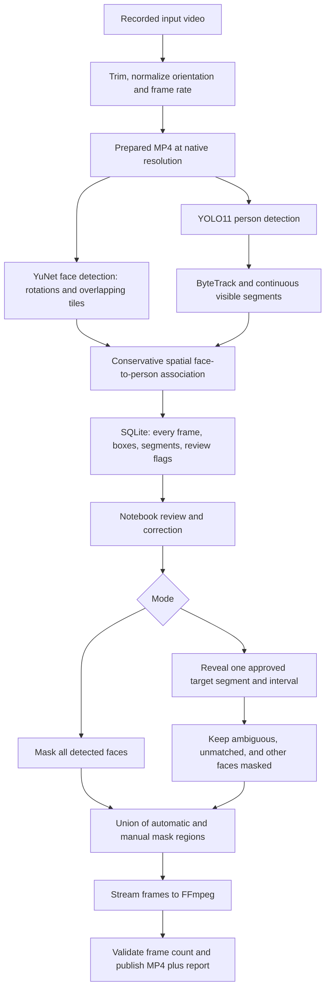

# CCTV Privacy — Colab

[](https://colab.research.google.com/github/DooJinWon/cctv-colab/blob/main/notebooks/CCTV_Privacy_Colab.ipynb)

A notebook-first Python project for masking faces in **recorded CCTV video**. It runs on a CPU or an available NVIDIA GPU, separates analysis from rendering, and supports revealing one manually reviewed target while retaining masks on everyone else.

This is a working prototype with automated tests, not a verified anonymization product. Automated detection can miss faces and tracking can switch identities. Exported videos are marked `UNREVIEWED_EXPORT` in their report until a person has reviewed the result. The software does not certify regulatory compliance.

## Start in Google Colab

Use the **Open in Colab** button above to load the notebook directly from this repository. For an initial CPU-only test, set `END_SECONDS = 10.0` in the input settings and keep `DEVICE = 'auto'` or choose `'cpu'`.

1. Download `notebooks/CCTV_Privacy_Colab.ipynb`.
2. Open [Google Colab](https://colab.research.google.com/), choose **File → Upload notebook**, and upload the file.
3. Run the setup and diagnostics cells. No GitHub repository, API key, or paid account is required for these steps.
4. Upload a short test video through Colab's **Files** panel. Set `INPUT_VIDEO` to its path.
5. Run preparation and analysis. The default processes at most the first **60 seconds**.
6. Open the review controls. Inspect the video and add corrections before running the export cell.
7. Export and download the MP4 and report. Keep audio disabled unless you need it.

The notebook embeds the complete source package and tests; uploading another ZIP is unnecessary. Installing dependencies requires Internet access. The first analysis also downloads pretrained model weights. In Colab, use **Runtime → Change runtime type** when GPU resources become available; CPU execution works for a small smoke test.

**Do not run all cells unattended:** stop at the review cell, make your edits, then run export. Colab sessions are temporary; download results and optional project backups before disconnecting. The optional private project backup contains the prepared, unredacted video and its audio.

## Processing flow



## Implemented behavior

- Pretrained **YOLO11n** person detection and **ByteTrack** tracking; no fine-tuning or biometric enrollment.
- **YuNet 2023mar**, using OpenCV 4.x, detects faces independently of person tracking.
- Face inference at 0°, 90°, 180°, and 270°, with optional overlapping tiles for small faces.
- Every prepared video frame is analyzed. The program never relies on motion detection and never intentionally skips frames.
- Unmatched faces remain masked. A detected person with no unambiguously associated face is masked over the **whole person**, including horizontal/lying boxes.
- Short-lived previous face regions remain masked after a missed detection.
- Tracking gaps, large position jumps, and candidate scene cuts start new reveal segments. A returned person needs another explicitly reviewed segment selection.
- Reveal permissions require an approved segment and frame interval, stable tracking, one associated face, and no detected person-box overlap above the configured threshold.
- Manual masks can be fixed or interpolate linearly between bounding-box keyframes. They always override reveal permissions.
- Mosaic, strong Gaussian blur, and solid black masks; audio excluded from exported results by default.
- Input and analysis hashes, exact output frame-count validation, partial-output cleanup, and refusal to overwrite an existing final export.
- SQLite frame metadata and streaming rendering avoid keeping an entire video in RAM.

## Repository layout

```text
cctv-colab/
├── cctv_privacy/
│   ├── cli.py          # Prepare/analyze/render command-line entry points
│   ├── detectors.py    # YOLO, YuNet, rotations, tiling, tracking segments
│   ├── geometry.py     # Pixel-coordinate transforms and box operations
│   ├── pipeline.py     # Analysis pass and review-event generation
│   ├── policy.py       # Approved reveal intervals and manual mask policy
│   ├── render.py       # Mask application and validated video export
│   ├── review.py       # Private ipywidgets notebook interface
│   ├── store.py        # SQLite persistence
│   └── video.py        # FFmpeg preparation, I/O, hashes, encoding
├── notebooks/CCTV_Privacy_Colab.ipynb
├── docs/architecture.md
├── docs/validation.md
├── scripts/build_notebook.py
├── scripts/smoke_model.py
├── tests/
├── .github/workflows/tests.yml
├── .gitignore
├── pyproject.toml
├── requirements.txt
└── requirements-dev.txt
```

## Review workflow

The preview starts in **mask-all mode**. Enable the original-preview checkbox only when inspecting source detail.

1. Move the frame slider and inspect the segment labels drawn around people. The preview includes frame number, clip time, original-source time, and automated review flags.
2. Select a target segment from the dropdown. Set the inclusive start/end frames to the interval you have reviewed.
3. Confirm that the interval belongs to the intended person, then add the reveal interval.
4. Change Mode to the selected-target mode. Ambiguous or unstable frames can still remain masked inside an approved interval.
5. If the target reappears under a new segment, inspect that segment and add a separate interval for the same person. Different segments cannot have overlapping reveal intervals.
6. For missed regions, enable the coordinate grid and set a normalized box. Save its start position. Optionally save an end position to create a moving mask over the selected start/end frames.
7. Remove incorrect edits through the corresponding lists. Edits save to `edits.json` automatically.
8. Re-render from the prepared source, then watch the entire exported clip. Review flags are a triage aid and are not an exhaustive list of detection failures.

No public Gradio endpoint, tunnel, or external face-recognition API is started by this project. Files uploaded to Colab still reside on that cloud runtime.

## Local or university Jupyter installation

Use a Python environment with FFmpeg and ffprobe on `PATH`. The implementation is tested locally on Python 3.9; a current Colab Python runtime is also a target, but must be validated in the user's session.

```bash
python -m venv .venv
source .venv/bin/activate
python -m pip install -r requirements-dev.txt
python -m pip install --no-deps -e .
python -m pytest -q
```

OpenCV wheels share the `cv2` namespace. Use only one OpenCV wheel family in a given environment. The notebook setup removes competing headless/contrib wheel variants before installing the pinned `opencv-python` version.

```bash
python -m cctv_privacy.cli prepare data/input.mp4 projects/demo --end 60
python -m cctv_privacy.cli analyze projects/demo --device cpu
python -m cctv_privacy.cli render projects/demo artifacts/all_faces.mp4
python -m cctv_privacy.cli render projects/demo artifacts/selected.mp4 --edits projects/demo/edits.json
```

Use `--full` on `prepare` to process the complete input. `analyze --fast` disables rotated/tiled face inference for a smoke test; it reduces coverage. For a CUDA-enabled runtime, `--device cuda:0` selects the GPU. `auto` chooses CUDA when available and otherwise CPU; it does not use a Mac MPS device automatically.

## Runtime files and storage

```text
projects/demo/
├── prepared.mp4           # Unredacted normalized clip, possibly including audio
├── manifest.json         # Prepared dimensions/FPS/frame count and clip offset
├── analysis.sqlite       # Per-frame detections, continuous segments, review events
├── analysis_summary.json # Timing, analyzed frame count, review counts
├── review_events.csv     # Frame, clip time, original time, flag reason
├── edits.json            # Reviewed reveal intervals and manual masks
└── models/               # Downloaded weights; ignored by Git

artifacts/
├── export.mp4
└── export.report.json    # Exact edit plan, analysis ID, policy hash, frame count
```

Preparation creates an additional compressed clip at native resolution, padding odd dimensions by at most one pixel. VFR inputs are converted to CFR; duplicate/drop decisions during this normalization follow FFmpeg's FPS filter. The analysis then covers **every normalized frame**. Coordinates and frame indices always refer to that prepared clip, not the original VFR frame indices.

Analysis can take longer than playback, especially on CPU with rotation/tiling. Re-rendering does not repeat inference. There is no automatic promise of real-time performance or fixed memory consumption.

## Validation

See [validation.md](docs/validation.md) for executed checks and their limits. Tests cover rotation transforms, reveal boundaries, ambiguous associations, whole-person fallback, manual-mask precedence, tracking gaps, exact frame counts, audio options, source-hash checks, and fail-closed export behavior. They do not establish accuracy on kindergarten CCTV.

To run an optional real-model smoke test on a non-sensitive image containing visible people and faces:

```bash
python scripts/smoke_model.py /path/to/test_image.jpg /path/to/new_smoke_directory
```

## Git and notebook updates

The repository ignores video files, model weights, SQLite data, runtime projects, caches, and environment files. Keep notebook outputs cleared before committing; outputs may contain video frames. The generated notebook ships with no execution outputs.

After changing source, tests, dependencies, or documentation:

```bash
python scripts/build_notebook.py
python -m pytest -q
git diff --check
git add cctv_privacy notebooks docs scripts tests README.md requirements*.txt pyproject.toml .gitignore .github
git commit -m "Update CCTV notebook and processing pipeline"
```

The build embeds a deterministic ZIP of the current source in the notebook. Regenerate it after source changes so the uploadable notebook and repository stay synchronized.

## Limits and next steps

- Lying, occluded, low-light, and tiny faces can still be missed. Rotation and tiling are heuristics, not a guarantee.
- A single uninterrupted track can still switch identities. Reviewed intervals reduce exposure but do not prove identity.
- Face-box/person-box overlap is a conservative spatial rule, not a trained identity classifier.
- Whole-person fallback can hide useful context. No separate head detector or pose model is included in this version.
- Manual moving boxes interpolate linearly; use shorter intervals when movement changes direction.
- There is no resumable tracker checkpoint. Interrupted analysis must restart; completed analysis can be reused.
- No fine-tuning, multi-camera identity matching, production authentication, background job service, or compliance certification is implemented.
- Voice, name tags, and other identifying information are outside automatic face masking. Audio export is an explicit option.

## Upstream components

- [Ultralytics YOLO11](https://docs.ultralytics.com/models/yolo11/) and [tracking](https://docs.ultralytics.com/modes/track/)
- [OpenCV YuNet](https://github.com/opencv/opencv_zoo/tree/main/models/face_detection_yunet)
- [OpenCV-maintained YuNet mirror](https://huggingface.co/opencv/face_detection_yunet)
- [FFmpeg](https://ffmpeg.org/ffmpeg.html)
- [Jupyter Widgets](https://ipywidgets.readthedocs.io/)

Ultralytics is distributed under AGPL-3.0 or its commercial license; YuNet's model directory declares MIT licensing. The full project's distribution and deployment must preserve applicable upstream terms. Third-party weights and example images are downloaded at runtime and are not included in this repository.
